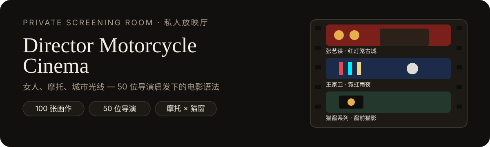
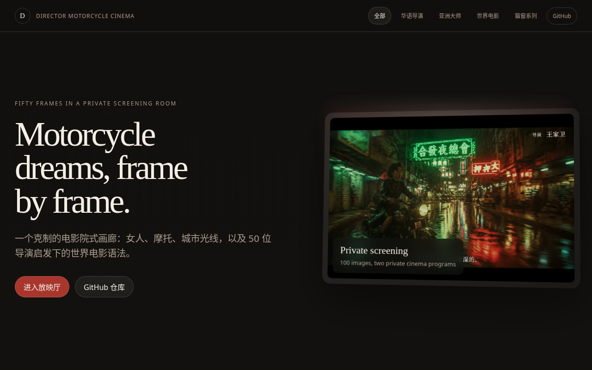
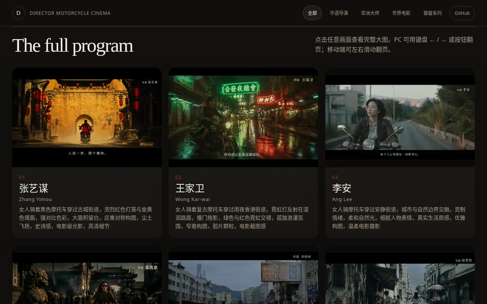

<p align="right"><a href="README.md">中文</a></p>

<p align="center">
  
</p>

<p align="center">
  <a href="https://xiaosang.cc/director-motorcycle-cinema/">▶ View Online</a>
  ·
  <a href="https://github.com/holynova/director-motorcycle-cinema">GitHub Repository</a>
</p>

Director Motorcycle Cinema is a cinema-styled static gallery: 100 director-inspired artworks in two programs — 50 of a woman riding a motorcycle through the city, each reimagined in one director's cinematic language, and 50 of the Cat Window series, a woman holding a cat by the window. Dark private-screening-room style, uniform 3:2 cards, full-size lightbox viewing.

## Screenshots

<p align="center">
  
</p>

<p align="center">
  
</p>

## Two Programs

| Program | Count | Theme |
|---|---|---|
| 摩托系列 Motorcycle | 50 | A woman riding a motorcycle through the city: 20 Chinese-language directors, 6 Asian masters, 24 world cinema |
| 猫窗系列 Cat Window | 50 | A woman holding a cat by the window (the same directors' styles, images generated with ChatGPT) |

20 Chinese-language directors: 张艺谋 Zhang Yimou, 王家卫 Wong Kar-wai, 李安 Ang Lee, 陈凯歌 Chen Kaige, 贾樟柯 Jia Zhangke, 侯孝贤 Hou Hsiao-hsien, 杨德昌 Edward Yang, 杜琪峰 Johnnie To, 徐克 Tsui Hark, 关锦鹏 Stanley Kwan, 姜文 Jiang Wen, 毕赣 Bi Gan, 娄烨 Lou Ye, 胡金铨 King Hu, 蔡明亮 Tsai Ming-liang, 吴宇森 John Woo, 许鞍华 Ann Hui, 冯小刚 Feng Xiaogang, 宁浩 Ning Hao, 田壮壮 Tian Zhuangzhuang. 6 Asian masters: 黑泽明 Akira Kurosawa, 宫崎骏 Hayao Miyazaki, 今敏 Satoshi Kon, 朴赞郁 Park Chan-wook, 奉俊昊 Bong Joon-ho, 金基德 Kim Ki-duk. 24 world cinema: 库布里克 Stanley Kubrick, 希区柯克 Alfred Hitchcock, 费里尼 Federico Fellini, 塔可夫斯基 Andrei Tarkovsky, 斯科塞斯 Martin Scorsese, 科波拉 Francis Ford Coppola, 斯皮尔伯格 Steven Spielberg, 雷德利·斯科特 Ridley Scott, 大卫·芬奇 David Fincher, 昆汀·塔伦蒂诺 Quentin Tarantino, 诺兰 Christopher Nolan, 韦斯·安德森 Wes Anderson, 蒂姆·伯顿 Tim Burton, 阿莫多瓦 Pedro Almodóvar, 吉尔莫·德尔·托罗 Guillermo del Toro, 戈达尔 Jean-Luc Godard, 特吕弗 François Truffaut, 阿涅斯·瓦尔达 Agnès Varda, 安东尼奥尼 Michelangelo Antonioni, 赛尔乔·莱昂内 Sergio Leone, 泰伦斯·马利克 Terrence Malick, 维伦纽瓦 Denis Villeneuve, 加斯帕·诺 Gaspar Noé, 格蕾塔·葛韦格 Greta Gerwig.

## Features

- **Filters**: 全部 All / 华语导演 Chinese-language / 亚洲大师 Asian masters / 世界电影 World cinema / 猫窗系列 Cat Window.
- **Lightbox**: click any card for the full image; desktop buttons + ← / → keys to page, mobile swipe to page, plus a landscape-fullscreen button on phones.
- **No cropping**: uniform 3:2 card areas with `object-fit: contain` — the whole image shows, nothing is cropped.
- **Bilingual cards**: each card carries the director's Chinese and English name, a Chinese tagline and a scene description.
- **Multi-format images**: every image ships in AVIF + WebP at several sizes (full / 960 / thumbnail / 480 thumbnail), served via `<picture>` as needed.

## Run Locally

A pure static site, zero framework, zero build — a single `index.html` with inline styles and scripts:

```bash
python3 -m http.server 8000
# Open http://127.0.0.1:8000
```

## Tech

- Zero framework dependencies; all 100 cards are rendered directly in `index.html` (not fetched by JS); `manifest.json` and `cat-window-manifest.json` are the image inventories.
- Images in six size directories: `assets/images/` (WebP originals), `assets/images-avif/`, `assets/images-960-avif/`, `assets/thumbs/`, `assets/thumbs-avif/`, `assets/thumbs-480-avif/`, with the Cat Window series under `assets/cat-window/` in the same six tiers.

```
index.html                  The whole site in one file: styles + 100 cards + lightbox script
manifest.json               Motorcycle series inventory (50): director, tagline, description, image path
cat-window-manifest.json    Cat Window series inventory (50)
assets/                     Motorcycle series images (6 formats)
assets/cat-window/          Cat Window series images (6 formats)
```
