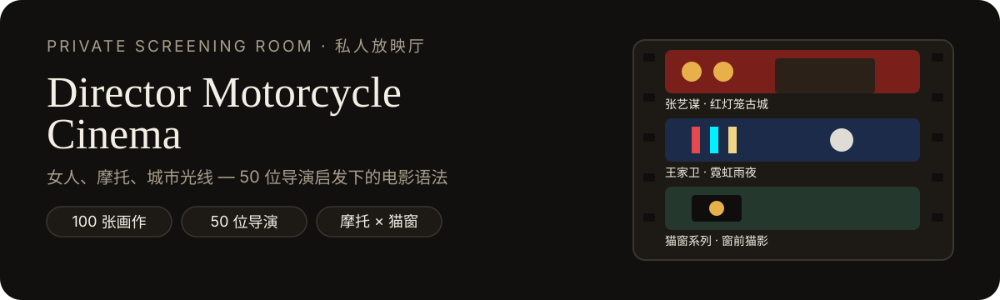
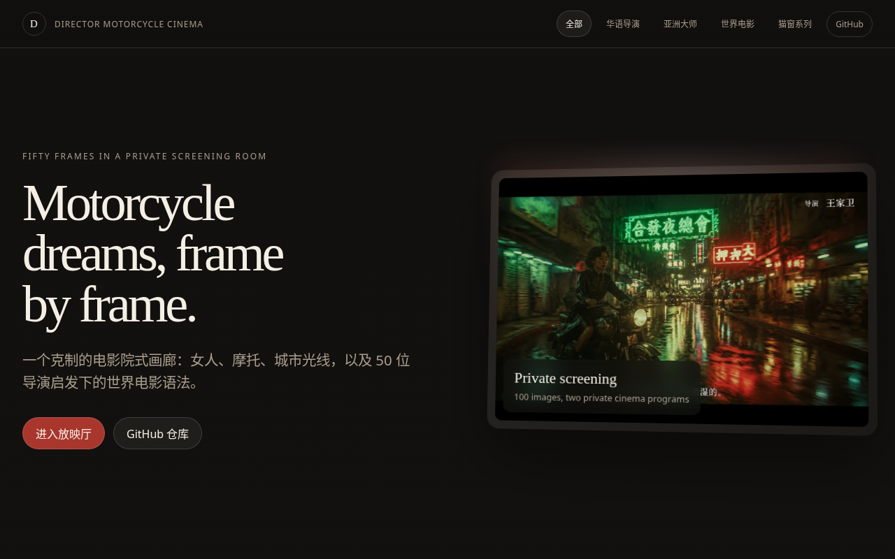
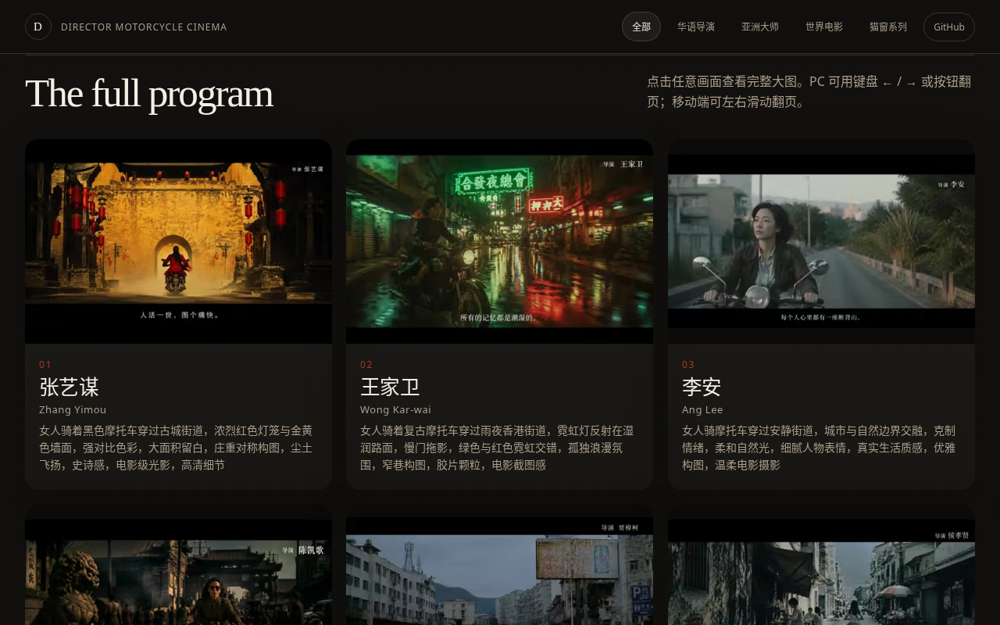

<p align="right"><a href="README.en.md">English</a></p>

<p align="center">
  
</p>

<p align="center">
  <a href="https://xiaosang.cc/director-motorcycle-cinema/">▶ 在线体验</a>
  ·
  <a href="https://github.com/holynova/director-motorcycle-cinema">GitHub 仓库</a>
</p>

Director Motorcycle Cinema 是一间电影院式的静态画廊：100 张导演风格画作，分两个放映节目——50 张「女人骑摩托穿过城市」，每张以一位导演的电影视觉语言重写同一主题；50 张「猫窗系列」，女人抱着猫在窗前看风景。深色私人放映厅风格，等比 3:2 卡片，点开灯箱看完整大图。

## 截图

<p align="center">
  
</p>

<p align="center">
  
</p>

## 两个节目

| 节目 | 数量 | 主题 |
|---|---|---|
| 摩托系列 | 50 | 女人骑摩托穿过城市：华语导演 20、亚洲大师 6、世界电影 24 |
| 猫窗系列 | 50 | 女人抱着猫在窗前看风景（同一批导演风格，ChatGPT 出图） |

华语导演 20 位：张艺谋、王家卫、李安、陈凯歌、贾樟柯、侯孝贤、杨德昌、杜琪峰、徐克、关锦鹏、姜文、毕赣、娄烨、胡金铨、蔡明亮、吴宇森、许鞍华、冯小刚、宁浩、田壮壮。亚洲大师 6 位：黑泽明、宫崎骏、今敏、朴赞郁、奉俊昊、金基德。世界电影 24 位：库布里克、希区柯克、费里尼、塔可夫斯基、斯科塞斯、科波拉、斯皮尔伯格、雷德利·斯科特、大卫·芬奇、昆汀·塔伦蒂诺、诺兰、韦斯·安德森、蒂姆·伯顿、阿莫多瓦、吉尔莫·德尔·托罗、戈达尔、特吕弗、阿涅斯·瓦尔达、安东尼奥尼、赛尔乔·莱昂内、泰伦斯·马利克、维伦纽瓦、加斯帕·诺、格蕾塔·葛韦格。

## 功能

- **分类筛选**：全部 / 华语导演 / 亚洲大师 / 世界电影 / 猫窗系列。
- **灯箱预览**：点任意卡片看完整大图；桌面端按钮 + 键盘 ← / → 翻页，移动端左右滑动翻页，手机上还有横屏全屏按钮。
- **等比不裁切**：全部卡片 3:2 等比图区，`object-fit: contain` 完整展示、不裁切。
- **中英双语卡片**：每张卡片有导演中英文名、一句中文题词与画面描述。
- **多格式图片**：每张图有 AVIF + WebP 多档（原图 / 960 / 缩略图 / 480 缩略图），`<picture>` 按需取用。

## 本地运行

纯静态站，零框架、零构建，单文件 `index.html`（样式与脚本内联）：

```bash
python3 -m http.server 8000
# 打开 http://127.0.0.1:8000
```

## 技术

- 零框架依赖；100 张卡片全部在 `index.html` 里直出（非 JS 拉取），`manifest.json` 与 `cat-window-manifest.json` 是图片清单。
- 图片分 6 档目录：`assets/images/`（WebP 原图）、`assets/images-avif/`、`assets/images-960-avif/`、`assets/thumbs/`、`assets/thumbs-avif/`、`assets/thumbs-480-avif/`，猫窗系列在 `assets/cat-window/` 下同样 6 档。

```
index.html                  单文件整站：样式 + 100 张卡片 + 灯箱脚本
manifest.json               摩托系列 50 条清单：导演、题词、描述、图片路径
cat-window-manifest.json    猫窗系列 50 条清单
assets/                     摩托系列图片（6 档格式）
assets/cat-window/          猫窗系列图片（6 档格式）
```
